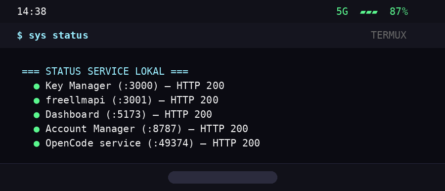

<div align="center">

# ☠️ Termux AI Gateway Setup

**🚀 Stack OpenCode + Multi-Provider Gateway untuk Termux (Android) 📱**


[](INSTALL.md)

</div>

Satu stack gateway AI lokal di Termux yang menyatukan **OpenCode**, **FreeLLMAPI**, **OpenRouter**, **Google/Gemini**, dan **NVIDIA** di balik satu script auto-start. Cukup tap widget Termux — semua provider langsung aktif, wake lock terkunci, OpenCode siap dipakai.

> Semua proses pakai `setsid` + `termux-wake-lock`, jadi tetap hidup walau layar mati, widget ditutup, atau Android masuk Doze.

---

## 📖 Apa itu Termux AI Gateway Setup?

Ini adalah kumpulan script & konfigurasi untuk mengubah Termux jadi **AI gateway station**:

- Menyalakan **5 service lokal** sekaligus dari satu perintah.
- Menyediakan **proxy multi-provider** dengan auto-failover saat kena rate limit.
- Mengelola **akun OpenCode** lewat dashboard web lokal.
- Terintegrasi dengan **Termux:Widget** — tanpa perlu buka terminal dulu.
- API key & data sensitif **tidak pernah ikut ter-commit**.

Cocok untuk kamu yang:

- pakai OpenCode sebagai coding agent utama;
- mau memanfaatkan model gratis (OpenRouter free, NVIDIA free, Google Gemma) tanpa ribet ganti-ganti config;
- butuh gateway lokal yang tetap nyala di background;
- ingin backup stack yang rapi & siap pakai lagi setelah reinstall Termux.

---

## ✨ Fitur

| # | Modul | Kemampuan | Port / Akses |
|---|-------|-----------|--------------|
| 1 | 🧠 **OpenCode** | Coding agent (CLI + Web GUI via pairing) | service internal |
| 2 | 🔑 **Key Manager** | Proxy multi-provider + auto-failover | `127.0.0.1:3000` |
| 3 | 🌐 **FreeLLMAPI** | Gateway lokal + auto-router model gratis | `127.0.0.1:3001` |
| 4 | 🖥️ **FreeLLMAPI Dashboard** | Web UI gateway (key, model, setting) | `127.0.0.1:5173` |
| 5 | 👤 **Account Manager** | Kelola & ganti akun OpenCode aktif | `127.0.0.1:8787` |

### Provider yang didukung

| Provider | Model contoh | Via |
|----------|--------------|-----|
| 🌐 **OpenRouter (free)** | Gemma 4, Nemotron, Ling 3.2, LFM3 | `openrouter-free` |
| 🟢 **NVIDIA (free)** | Nemotron 3.5 Lightning, Gemma 4, GLM 5.3 | `nvidia-free` |
| 🔍 **Google / Gemini** | Gemma 4 31B, Lyria 3, DiffusionGemma, Paligemma | OpenRouter + NVIDIA + Key Manager |
| 🆓 **FreeLLMAPI Auto** | Auto-router model gratis | `freellmapi` (lokal) |
| ⚡ **Groq / DeepSeek / Together** | Failover via Key Manager | `bin/cli.js` |

### Fitur pendukung

- 🔒 Wake lock otomatis — CPU tidak tidur saat layar mati.
- 🧵 `setsid` pada semua proses — tidak ikut mati saat sesi/widget ditutup.
- 🔁 Idempotent — script cek port dulu, tidak bikin proses dobel.
- 📝 Log terpusat di `~/.local/log/services/`.
- 🧩 Termux:Widget ready — cukup tap, tidak buka terminal.
- 🔐 API key di-redact di repo, `.gitignore` menahan file sensitif.

---

## 📸 Tampilan Aplikasi

Semua service lokal aktif — cek kesehatan sekali lihat.

<div align="center">



</div>

---

## ⚙️ Cara Kerja

```
Termux:Widget (tap)
        │
        ▼
bin/start-all-services
        │
        ├── termux-wake-lock          → CPU tetap hidup
        │
        ├── Key Manager     :3000     → OpenRouter / Groq / DeepSeek / Gemini / Together
        ├── FreeLLMAPI      :3001     → auto-router model gratis
        ├── Dashboard       :5173     → web UI gateway
        ├── Account Manager :8787     → kelola akun OpenCode
        └── OpenCode service         → backend CLI + Web GUI
```

1. Widget memanggil `start-all-services`.
2. Wake lock diaktifkan, lalu tiap service dicek port-nya.
3. Yang belum jalan dimulai via `setsid` (terlepas dari terminal).
4. OpenCode langsung bisa pakai semua provider.

---

## 📋 Prasyarat

| Kebutuhan | Keterangan |
|-----------|------------|
| **Termux** | Disarankan dari F-Droid / GitHub, bukan Play Store |
| **Termux:Widget** | Untuk tap-to-start dari home screen |
| **Node.js** | Key Manager & FreeLLMAPI server |
| **Python 3** | Account Manager |
| **OpenCode** | Coding agent utama |
| **Koneksi internet** | Untuk provider remote (OpenRouter, NVIDIA, Google) |

Dependency utama:

| Di Termux | Fungsi |
|-----------|--------|
| `bash`, `curl`, `git`, `gh` | script & GitHub |
| `node`, `npm` | Key Manager, FreeLLMAPI |
| `python3` | Account Manager |
| `termux-wake-lock`, `termux-open-url` | dari `termux-tools` |
| `setsid` | detach proses (dari `util-linux`) |

---

## ⚡ Cara Install

**Cara tercepat — satu perintah:**

```bash
git clone https://github.com/blukutupluk/termux-ai-gateway-setup.git
cd termux-ai-gateway-setup
bash install.sh
```

Atau lihat **[INSTALL.md](INSTALL.md)** untuk panduan manual & penjelasan tiap langkah.

---

## 🔧 Pemakaian

```bash
# Nyalakan semua service (wake lock + setsid)
~/bin/start-all-services

# Buka dashboard gateway
termux-open-url http://127.0.0.1:5173

# Kelola akun OpenCode
termux-open-url http://127.0.0.1:8787

# Buka OpenCode (GUI web via pairing)
sambungopencode

# Cek status semua port
for p in 3000 3001 5173 8787; do printf "$p: "; curl -s -o /dev/null -w "%{http_code}\n" http://127.0.0.1:$p/; done
```

Atau cukup **tap widget `sambungopencode`** di home screen. ☠️

---

## 📁 Struktur

```
termux-ai-gateway-setup/
├── bin/
│   ├── start-all-services      ← script master (dipanggil widget & .bashrc)
│   ├── keymanager              ← CLI Key Manager
│   ├── opencode-account        ← CLI kelola akun
│   ├── cli.js                  ← server proxy multi-provider
│   ├── sambungopencode         ← buka OpenCode + pairing
│   └── freellmapi-launcher     ← kontrol FreeLLMAPI
├── src/                        ← source Key Manager + routes
├── shortcuts/                  ← script Termux:Widget
├── config/opencode/
│   ├── opencode.example.json   ← contoh config (key di-redact)
│   └── tools/opencode-account-manager/
├── docs/KEYMANAGER.md
├── bashrc.example              ← contoh .bashrc (key di-redact)
├── install.sh
└── README.md
```

---

## 🔐 Keamanan

- API key diganti placeholder di repo (`YOUR_API_KEY_HERE`).
- `.gitignore` menahan `.env`, `service.json`, `*.log`, `data.json`, `opencode.json`, `.bashrc`.
- Semua service listen di `127.0.0.1` — tidak terekspos ke jaringan.
- Opsi `--remote` pada `sambungopencode` sengaja ditolak.

---

## 📝 Log

Semua log terpusat di:

```
~/.local/log/services/
├── keymanager.log
├── freellmapi.log
├── freellmapi-dashboard.log
└── account-manager.log
```

---

<div align="center">

Dibuat dengan ☕ di Termux — oleh [@blukutupluk](https://github.com/blukutupluk)

**☠️ Termux AI Gateway Setup** — *tap widget, semua provider nyala.*

</div>
